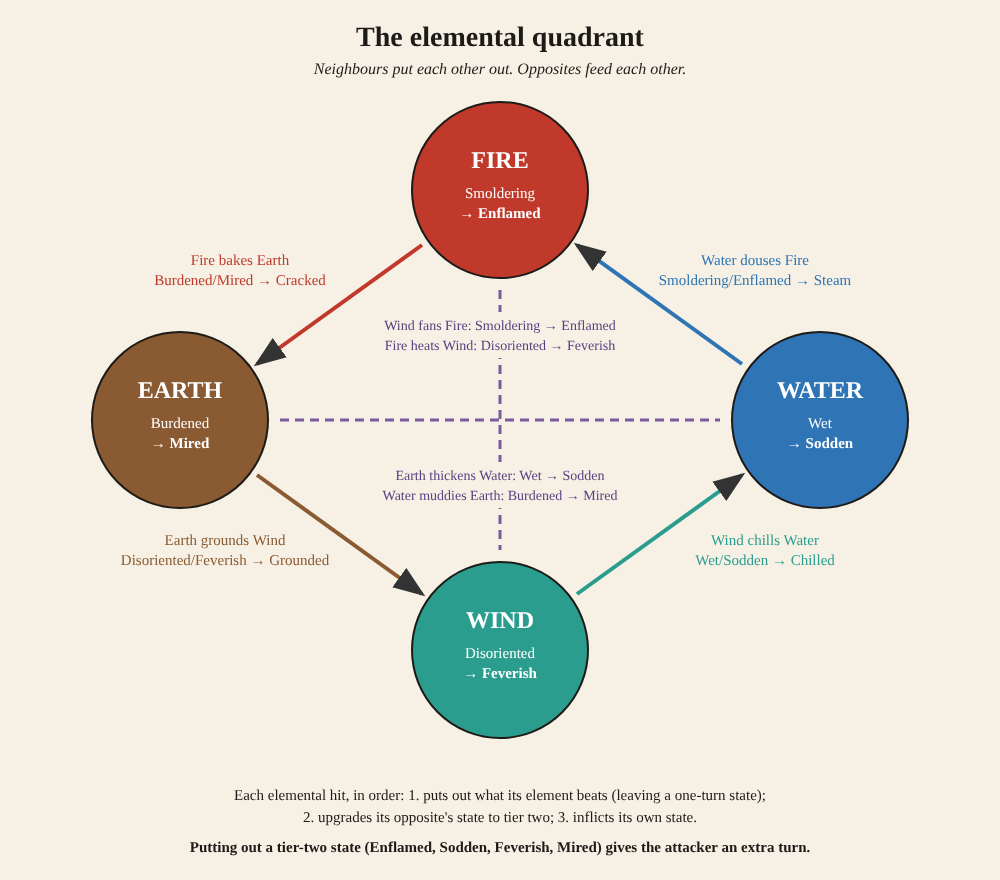

# Status effects (player's view)

The things a player would call "status effects": the bad ones that stick to
a fighter and change how a fight goes. Buffs (Focused, Calm, Happy, Brave and
so on) and bookkeeping states (stances, Pointed Out, Hunted) aren't listed.

## Elemental

Each element leaves its own mark, and a second hit of the opposite element
makes it worse (tier two). A neighbouring element puts it out, leaving a
one-turn state behind. All last 3 turns unless noted.

| Element | Tier one | Tier two |
|---|---|---|
| Fire | **Smoldering**: loses 5% Health a turn | **Enflamed**: loses 12% Health a turn, and loses every other turn |
| Water | **Wet**: takes 15% more physical damage | **Sodden**: takes 35% more physical damage, can't use Magic |
| Earth | **Burdened**: Speed −20% | **Mired**: Speed −45%, no physical skills or Punch |
| Wind | **Disoriented**: Hit −15% | **Feverish**: Hit −35%, 30% chance a turn to lash out at anyone |

What's left when one is put out (1 turn):

| Left behind | Effect | Comes from |
|---|---|---|
| **Steam** | Hit −50% | Water putting out Fire |
| **Chilled** | Speed −60% | Wind putting out Water |
| **Grounded** | Might −50% | Earth putting out Wind |
| **Cracked** | Takes 60% more physical damage | Fire putting out Earth |

## Physical

| Effect | What it does | Lasts | Cured by |
|---|---|---|---|
| **Venom** | Loses 5% Health a turn; healing is halved | 4 turns | Hill Thyme Tea, Electric Cautery, Raau |
| **Bleed** | Loses 6% Health a turn | 3 turns | Bandage, Electric Cautery |
| **Salting** | Speed −30%; turns to salt (knocked out) when it runs out | 3 turns | Any water |
| **Dragged Below** | Pulled out of the fight; knocked out unless the dragger is hit first | 3 turns | Hitting the dragger |
| **Entangled** | Loses the next turn (nets) | 1 turn | — |
| **Stunned** | Loses the next turn (an electric shock while Sodden) | 1 turn | — |
| **Dazzled** | Hit −50% | 1 turn | — |
| **Blinded** | Hit −50%, no ranged attacks | 3 turns | — |
| **Held** | Can't dodge or flee | while held | — |
| **Brought Down** | Can't fly | 2 turns | — |
| **Tipsy** | Hit −10%, but shrugs off Despair and Panicked; more drink turns it into Disoriented | — | — |
| **Weary** | At full Fatigue | until rested | Rest, food |

## Mental

Kami cures all of these; Clear-Minded makes a fighter immune for 2 turns.

| Effect | What it does | Lasts | Cured by |
|---|---|---|---|
| **Confused** | Deals 25% less damage, takes 25% more; may do nothing (20%) or run (10%) | — | Kami |
| **Enraged** | Might up; Speed and Endurance down; no Magic; won't listen to Talk | — | Kami |
| **Despair** | Loses 10% Mana a turn; may do nothing or run | — | Kami |
| **Panicked** | Spirit up; Speed and Resolve down; no physical skills | — | Kami |
| **Hypnotized** | Attacks its own side; a hit has a 50% chance to snap it out | 2 turns | Pennyroyal, Kami |
| **Sleep** | Can't act; any hit wakes it | 3 turns | Pennyroyal, Kami, a hit |
| **Feverish** | (Wind tier two, above) counts as mental too | 3 turns | Kami, Earth |
